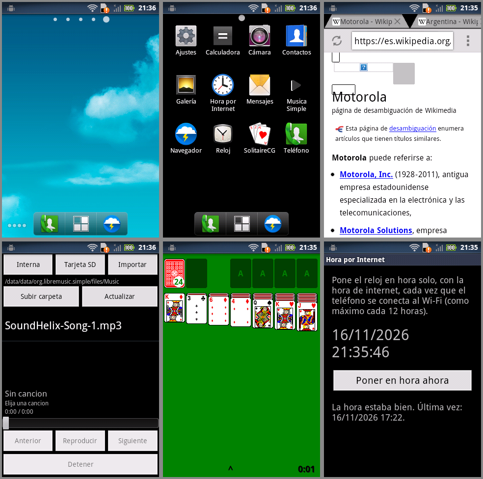

# Motorola XT550 libre

Cómo dejamos un **Motorola Motosmart Mix XT550** (Android 2.3.6, de 2012) limpio, rápido y con software libre, para que lo use mi papá: llamadas, SMS, contactos, cámara, música, solitario, reloj, calculadora y un navegador que abre páginas modernas.

Todo lo que se instaló se **compiló desde el código fuente** después de revisarlo. No se usaron APK precompilados, ni siquiera de F-Droid. Cada app tiene su repositorio (fork del original) con los cambios y un *release* con el APK y su SHA256. El archivo que bajás de GitHub, el que compilamos y el que está instalado en el teléfono son el mismo, verificado byte por byte.

*Inicio, cajón de apps, Navegador (Wikipedia por TLS 1.3), Música Simple, Solitario en vertical y Hora por Internet.*

## Antes y después

| | Antes | Después |
|---|---|---|
| Paquetes instalados | 112 | 35 |
| Apps de Google, Facebook, Twitter, Motoblur, clima, etc. | sí | ninguna |
| Envío de datos a terceros (Google, Motorola, Tencent por el gestor de root) | sí | no encontramos ninguno |
| RAM libre después de arrancar | ~23 MB (+135 MB caché) | ~270 MB |
| Espacio libre en `/flex` / `/data` | 6 MB / 116 MB | 70 MB / 130 MB |
| Teclado en español con sugerencias | no (el de Motorola no tenía diccionario) | sí, 60.000 palabras |
| Páginas HTTPS modernas (Google, Wikipedia, bancos, gobierno) | no abrían (TLS 1.0) | sí, TLS 1.2 y 1.3 |
| Porcentaje de batería | no | en el ícono, de a 1 % |
| Hora | manual; se desconfigura | se pone sola por internet |

## Las apps

| App | Qué es | Código (fork) | Release | Qué le cambiamos |
|---|---|---|---|---|
| **Navegador** | Lightning Browser 3.0.5 | [Lightning-Browser](https://github.com/facundosterzerforino/Lightning-Browser/tree/xt550-libre) | [xt550-3.0.5-tls-r2](https://github.com/facundosterzerforino/Lightning-Browser/releases/tag/xt550-3.0.5-tls-r2) | **HTTPS moderno (TLS 1.3) con mbedTLS 3.6.7** dentro del WebView de Android 2.3; raíces de Mozilla; lista de descargas propia; aviso si la fecha está mal; sin favicons de Google ni permisos de ubicación; en español. |
| **Teclado Libre** | Teclado AOSP 2.3.6 | [teclado-libre](https://github.com/facundosterzerforino/teclado-libre/tree/teclado-es) | [v2.3.6-es1](https://github.com/facundosterzerforino/teclado-libre/releases/tag/v2.3.6-es1) | Diccionario español de 60k palabras convertido al formato de 2.3, tecla ñ, sin micrófono. |
| **Música Simple** | App nuestra (desde cero) | [simple-music-player](https://github.com/facundosterzerforino/simple-music-player) | [v1.2.0](https://github.com/facundosterzerforino/simple-music-player/releases/tag/v1.2.0) | 17 KB. Memoria interna y tarjeta, sin internet. El botón físico de música pausa y reanuda. |
| **Pantalla de inicio** | ADW.Launcher 1.3.6 | [android_packages_apps_Launcher](https://github.com/facundosterzerforino/android_packages_apps_Launcher/tree/xt550-libre) | [xt550-1.3.6](https://github.com/facundosterzerforino/android_packages_apps_Launcher/releases/tag/xt550-1.3.6) | Solo arreglos para compilar. Reemplaza al lanzador 3D de Motorola. |
| **Reloj** | DeskClock AOSP 2.3.6 | [android_packages_apps_DeskClock](https://github.com/facundosterzerforino/android_packages_apps_DeskClock/tree/xt550-libre) | [xt550-2.3.6](https://github.com/facundosterzerforino/android_packages_apps_DeskClock/releases/tag/xt550-2.3.6) | Paquete propio (`org.librereloj`), sin permisos de sistema. |
| **Galería** | Gallery AOSP 2.3.6 | [android_packages_apps_Gallery](https://github.com/facundosterzerforino/android_packages_apps_Gallery/tree/xt550-libre) | [xt550-2.3.6](https://github.com/facundosterzerforino/android_packages_apps_Gallery/releases/tag/xt550-2.3.6) | 36 APIs ocultas reemplazadas, sin permisos de cámara/ubicación/SMS; la Cámara de Motorola la sigue abriendo. |
| **Calculadora** | Calculator AOSP 2.3.6 | [platform_packages_apps_calculator](https://github.com/facundosterzerforino/platform_packages_apps_calculator/tree/xt550-libre) | [xt550-2.3.6](https://github.com/facundosterzerforino/platform_packages_apps_calculator/releases/tag/xt550-2.3.6) | La librería `arity` compilada desde su fuente ([arithmetic](https://github.com/facundosterzerforino/arithmetic)) en vez del `.jar` incluido. |
| **Solitario** | SolitaireCG 3.4.1 | [solitairecg](https://github.com/facundosterzerforino/solitairecg/tree/xt550-libre) (espejo de SourceForge) | [xt550-3.4.1-r2](https://github.com/facundosterzerforino/solitairecg/releases/tag/xt550-3.4.1-r2) | Se puede jugar en vertical, con cartas más grandes. |
| **Hora por Internet** | App nuestra (desde cero) | [hora-por-internet](https://github.com/facundosterzerforino/hora-por-internet) | [v1.0](https://github.com/facundosterzerforino/hora-por-internet/releases/tag/v1.0) | Pone el reloj en hora con servidores NTP al conectarse al Wi-Fi (Android 2.3 solo lo hacía con la señal del chip). |
| **Superuser** | Superuser 3.3 (ChainsDD) | [Superuser](https://github.com/facundosterzerforino/Superuser/tree/xt550-libre) | [xt550-3.3](https://github.com/facundosterzerforino/Superuser/releases/tag/xt550-3.3) | Sin internet, sin binarios incluidos, librerías de soporte compiladas desde AOSP. |
| **su** | su 3.2 (ChainsDD) | [su-binary](https://github.com/facundosterzerforino/su-binary/tree/xt550-libre) | [xt550-3.2-r2](https://github.com/facundosterzerforino/su-binary/releases/tag/xt550-3.2-r2) | Compatible con Superuser 3.3; sin aviso por cada comando del USB. |
| **BusyBox** | BusyBox 1.38.0 | [busybox](https://github.com/facundosterzerforino/busybox/tree/xt550-libre) (espejo de git.busybox.net) | [xt550-1.38.0](https://github.com/facundosterzerforino/busybox/releases/tag/xt550-1.38.0) | Herramientas de consola para mantenimiento; compilado en Windows solo con el NDK. |

Otras cosas nuestras:

| | Repositorio |
|---|---|
| Batería con el número adentro, en el ícono del sistema | [xt550-battery-percent](https://github.com/facundosterzerforino/xt550-battery-percent) |
| Ver y manejar la pantalla del teléfono desde la PC por USB | [xt550-usb-viewer](https://github.com/facundosterzerforino/xt550-usb-viewer) |
| BatteryBot (lo usamos hasta tener el % en el ícono) | [Battery-Indicator-Free](https://github.com/facundosterzerforino/Battery-Indicator-Free/tree/xt550-gingerbread), [release](https://github.com/facundosterzerforino/Battery-Indicator-Free/releases/tag/xt550-10.0.1-beta1) |
| Probadas y descartadas (forks guardados) | [vanilla](https://github.com/facundosterzerforino/vanilla), [little-music-player](https://github.com/facundosterzerforino/little-music-player), [filemanager](https://github.com/facundosterzerforino/filemanager) |

Lo que **sigue siendo de Motorola**: Teléfono, Contactos, Mensajes, Cámara, Ajustes, la barra de estado y los servicios de sistema. Los drivers y el firmware no se pueden reemplazar.

## Paso a paso

El detalle de cada paso, con comandos, está en [docs/paso-a-paso.md](docs/paso-a-paso.md). En resumen:

1. **Respaldo.** Antes de tocar nada copiamos a la PC todas las apps de sistema (`/system/app` y `/flex/app`: 170 archivos) con su SHA256. Contra esa copia se verificó cada archivo antes de borrarlo.
2. **Root.** El exploit libre (zergRush) no funcionó en este firmware. Funcionó *Romaster* (herramienta china, cerrada), que instaló su propio gestor de root, una tienda de apps y un servicio de notificaciones de Tencent. Todo eso se reemplazó después (paso 9).
3. **Limpieza por etapas.** 11 tandas, siempre igual:
   - verificar el hash contra el respaldo;
   - guardar los datos de la app;
   - borrar;
   - reiniciar;
   - comprobar que el resto sigue andando.

   Antes de borrar algo que podían usar Teléfono, Mensajes o el sistema, analizamos el código con `dexdump`. Lista completa: [docs/paquetes-borrados.md](docs/paquetes-borrados.md).
4. **Pantalla de inicio y animaciones.** ADW en vez del lanzador 3D. Las animaciones se apagaron. Un grupo "Apps" en el cajón muestra solo lo que se usa.
5. **Fuera Google.** Play, servicios de Google, Maps, sincronización, búsqueda, etc. No había cuenta de Google.
6. **Música Simple y Teclado Libre.** Una app de música mínima propia y el teclado de Android con diccionario español.
7. **Regla: todo desde el código.** Para cada app libre:
   - fork del original;
   - revisar el código (permisos, red, rastreadores);
   - sacar los binarios incluidos y compilarlos desde su fuente;
   - publicar el release con su SHA256;
   - verificar que lo bajado, lo compilado y lo instalado coincidan.
8. **Apps de AOSP recompiladas.** Reloj, Galería, Calculadora, ADW y Solitario. Les pusimos paquete propio cuando hacía falta, para que se instalen como apps normales.
9. **Root libre.** `su` y Superuser compilados reemplazaron al gestor chino. También borramos dos copias ocultas de `su` que había dejado.
10. **Navegador con HTTPS moderno.** El WebView de Android 2.3 solo habla TLS 1.0, y casi ningún sitio lo acepta hoy. El Navegador ahora trae su propia capa TLS:
    - **mbedTLS 3.6.7** en C, vía JNI;
    - se conecta al WebView por reflexión, en `HttpsConnection.mSslSocketFactory`;
    - verifica certificados con las raíces de Mozilla;
    - funciona sin proxy y sin tocar el sistema.

    Detalle: [README del Navegador](https://github.com/facundosterzerforino/Lightning-Browser/blob/xt550-libre/README-XT550.md).
11. **Batería y ajustes.** Ver [docs/ajustes.md](docs/ajustes.md):
    - la pantalla ya no queda prendida mientras carga;
    - a batería, el Wi-Fi se apaga 15 minutos después de apagar la pantalla;
    - sin vibración al tocar;
    - zona horaria de Buenos Aires.
12. **Hora por Internet.** App propia: SNTP más `date -s` como root.
13. **Porcentaje en el ícono de batería.** Cambiamos 13 piezas de `framework-res.apk`: dígitos en lugar de 10 dibujos de batería, más 3 recetas con 101 niveles. La firma se mantiene válida y BatteryBot dejó de hacer falta.

## Si algo sale mal

[docs/recuperar.md](docs/recuperar.md) explica cómo volver atrás:
- una app borrada;
- el ícono de batería original;
- un ajuste;
- el root.

## Lo que no se pudo

- **WhatsApp**: pide Android 6 o más.
- **Lista de Descargas de Motorola**: no se puede reemplazar, porque necesita la firma de Motorola. El Navegador muestra sus propias descargas.
- **Páginas muy pesadas** (Clarín, MercadoLibre, YouTube): el motor que dibuja las páginas es de 2010; abren mal o piden un navegador más nuevo.
- **Sin microSD** todavía no se probaron:
  - fotos guardadas;
  - álbumes de la Galería;
  - descargas completas.
- **Radio FM**: se decidió no hacerla. El código de Broadcom que hay en internet no es libre.

## Herramientas

En [tools/](tools/) hay dos scripts reutilizables para otros teléfonos con Android 2.3 rooteado:
- `borrar_app_sistema.py`: borra apps de sistema con verificación contra el respaldo y copia de los datos. Por defecto solo verifica.
- `ajuste.py`: cambia un valor de `settings.db`, que es la única forma en 2.3.

[docs/lecciones.md](docs/lecciones.md) junta lo que aprendimos de Android 2.3: comandos que no existen, trampas del shell, `su`, SQLite, etc.

## Licencia

Los textos y scripts de este repositorio son MIT. Cada app mantiene la licencia de su proyecto original: Apache 2.0 (AOSP, ADW, Lightning, SolitaireCG), GPL (BusyBox, Hora por Internet) o MIT (Música Simple).
